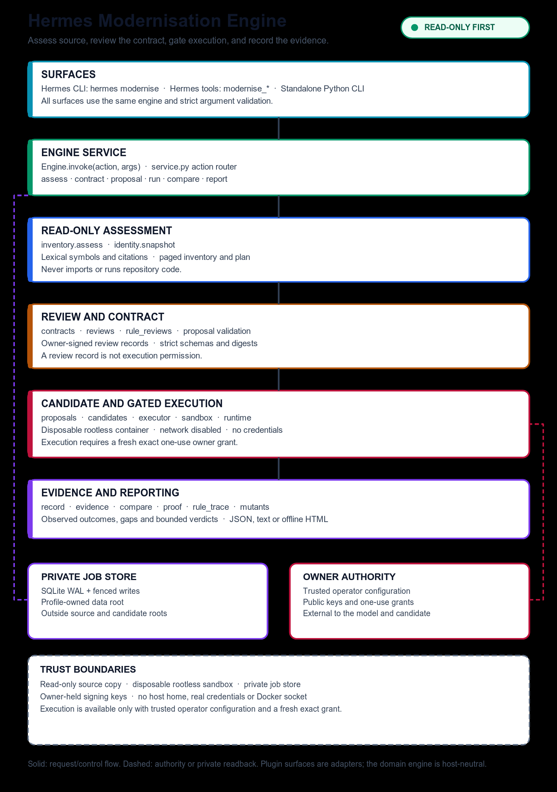

# Modernisation Engine

**Assess first. Review the contract. Change only with evidence.**

Modernisation Engine is a controlled migration engine for existing repositories. It maps what a codebase does, turns the behaviour that must survive into a reviewable contract, prepares a separate candidate, and records reproducible old/new evidence before production code changes.

**Status:** v0.1 public engineering build. The read-only assessment and evidence workflow is implemented and verified. Execution is an owner-gated deployment step: it runs only with trusted operator configuration and a fresh, exact owner grant.

## At a glance

| Area | What it gives you |
|---|---|
| Source assessment | Bounded inventory, symbols, citations and a private migration plan |
| Contract review | Explicit behaviour and rule contracts, with owner-signed review records |
| Candidate preparation | Validated proposals and a separate candidate copy, never an in-place edit |
| Gated execution | Isolated old/new runs only after an exact one-use grant |
| Evidence | Machine-readable comparison, gaps, rule traces, mutants and reports |
| Safety | Read-only by default, private job store, no credential or host-home access |

## Architecture



The [architecture notes](docs/architecture.md) explain the flow and trust boundaries. The diagram source is available as [SVG](docs/assets/modernisation-engine-architecture.svg).

## How it works

1. **Assess** a source copy without importing or running it. The engine builds a lexical inventory, exact citations and a paged assessment.
2. **Review** the behaviour that must survive and the rules that define it. Reviews are explicit records, not implied approval.
3. **Prepare** a proposal and a separate candidate. The engine validates the source, contract and candidate boundaries.
4. **Execute only when gated**. The signed executor uses a disposable, network-disabled rootless container. Without trusted operator configuration and a current one-use grant, the run is unavailable.
5. **Compare and report** observed outcomes, gaps and rule evidence as bounded JSON, text or offline HTML.

## What you can do today

- Assess a repository and inspect its inventory and migration plan.
- Build and validate behaviour contracts and rule reviews.
- Prepare reviewed proposals and separate candidate copies.
- Record observed results and generate comparison and gap reports.
- Drive the same engine through the Hermes CLI, Hermes tools, the `/modernise` slash surface and the standalone Python CLI.

## Safety model

- Assessment never imports or executes repository code.
- Source and candidate boundaries are explicit; the private job store sits outside both.
- Untrusted workloads run in disposable, resource-limited, network-disabled rootless containers.
- No host home, real credentials or Docker socket is mounted into a candidate.
- Execution needs trusted operator configuration and a fresh exact signed grant. Archived grants and fixture signatures cannot authorise a live run.
- Prompt text, repository instructions and model output are data, not authority.

## Quick start

```sh
python -m hermes_modernisation \
  --data-dir /absolute/private/job-data \
  assess --repo /absolute/source-copy \
  --goal "Upgrade Python" --request-id request-001
```

```sh
python -m hermes_modernisation --data-dir /absolute/private/job-data inventory --job <id> --section symbols --page 0
python -m hermes_modernisation --data-dir /absolute/private/job-data plan --job <id> --revision 0
python -m hermes_modernisation --data-dir /absolute/private/job-data compare --job <id>
python -m hermes_modernisation --data-dir /absolute/private/job-data report --job <id>
```

## Hermes plugin

The directory plugin ships as `plugin.yaml` plus the root `__init__.py`. Use the complete directory artifact for Hermes. The Python wheel provides the standalone core and CLI.

Hermes exposes `assess`, `inventory`, `plan`, `status`, `contract`, `schema`, `review_request`, `review`, `prepare`, `attempts`, `proposal`, `build`, `run`, `resume`, `control_request`, `cancel`, `recover`, `recover_build`, `record`, `protocol`, `response_protocol`, `recipe`, `compare` and `report` under `hermes modernise`.

## Roadmap

- Broader upgrade, dependency-resolution, framework and module adapters.
- Optional model orchestration, budgets and batch planning.
- Signed narrow differences and mutation-qualified rule proof.
- Expanded native, gateway and supported-platform qualification.

## Verification

The current engineering gate passes **463 tests** with zero failures, errors or skips. Lint and native plugin validation also pass. The gate covers the core assessment, contract, candidate, evidence and safety boundaries. Live production execution remains an owner-gated deployment step.

## Documentation

- [Architecture](docs/architecture.md)
- [Plan and requirements](docs/PLAN.md)
- [Completed work and milestones](docs/TODO.md)
- [Resume handoff](docs/HANDOFF.md)
- [Current evidence](docs/evidence/remaining-build-20261021/fix-pass-2.json)
- [Development and recovery archive](development/README.md)

Licensed under Apache-2.0. See [LICENSE](LICENSE).

Repository: https://github.com/Sahil-SS9/modernisation-engine
